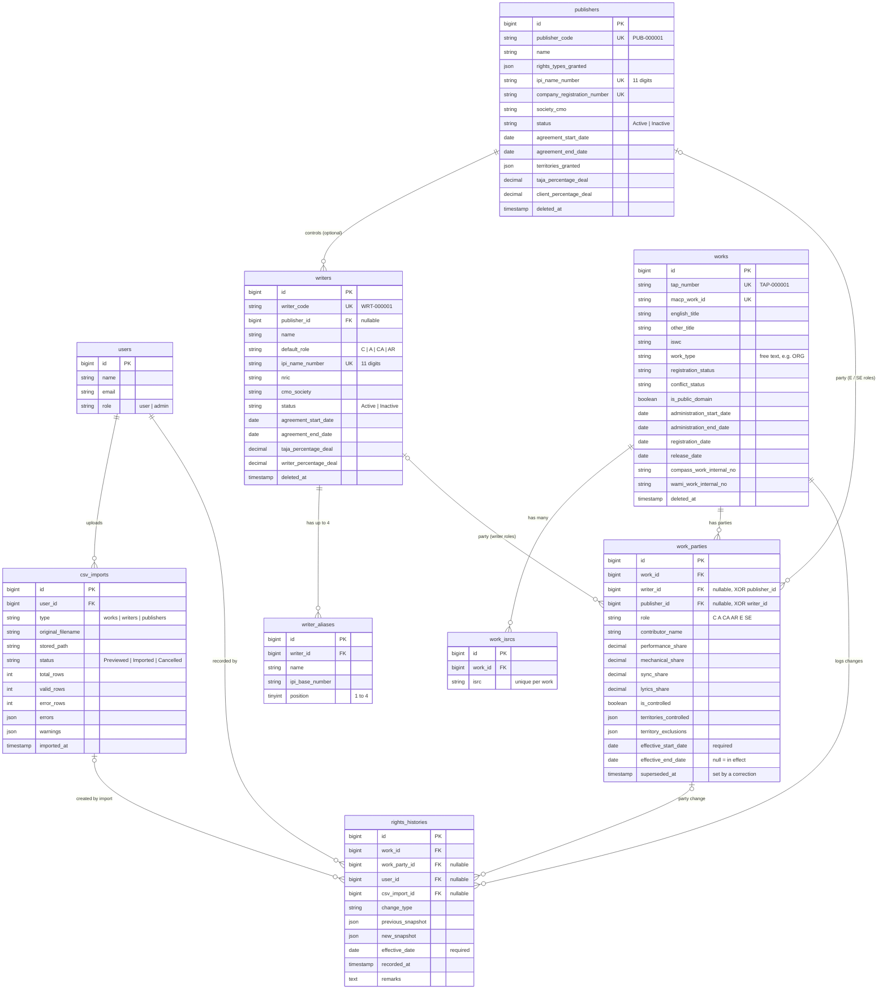

# PHASE 1 — Master Plan (House of TAJA Rights Management System)

> **How to use this file:** attach `PHASE_1.md` as context to every Cursor Plan. Each plan in [Section 12](#12-build-plans-split-into-cursor-plans) is self-contained: tell Cursor "Build **Plan N** from PHASE_1.md". Sections 1–11 are the shared specification; if a plan and the spec disagree, the spec wins.

**Last updated:** 2026-11-06 (all eight plans built; Sections 2, 5.1, 5.8, 9.1, 9.4 and 11 updated to match the build: queued imports, larger limits, `countries` table, report notes)

---

## 1. Source of truth

The three client workbooks (latest, agreed after discussion) are the **only source of truth** for the data model:

| Workbook                                             | Becomes                        |
| ---------------------------------------------------- | ------------------------------ |
| `Music_Publishing_Works_Master_with Dictionary.xlsx` | Works + work parties (+ ISRCs) |
| `Writer Master_Meta with Dictionary.xlsx`            | Writers (+ aliases)            |
| `Publisher Client_Master with Dictionary.xlsx`       | Publishers (clients)           |

Everything else (`Project Proposal V2.pdf`, `House of TAJA - Publishing House Rights Management Framework.pdf`, `taja-project-resources/docs/*`, `erd.png`) is early-stage assumption and **must not override this file**. Where they differ (TAP as a supplied key, a single % per party, Google Drive links, 5 roles, Module I masters), follow this file.

The workbooks live in `taja-project-resources/` (gitignored). They contain real personal data. **Never commit them or paste real data into tests, seeders or factories.** Use fake data only.

The `Relationships` sheets in the workbooks are **ignored**. Create a child table only when this plan says so.

---

## 2. Scope

### In scope (Phase 1)

1. **Publishers** master — list, create/edit form, detail page.
2. **Writers** master — list, create/edit form, detail page (writer profile + catalogue), aliases.
3. **Works** (song catalogue) — list, create/edit form, detail page, multiple ISRCs, parties with per-rights-type shares.
4. **Rights history** — insert-only, dated change log per work; current vs historical view; point-in-time view.
5. **CSV bulk import** for works, writers and publishers, with downloadable templates, a field guide, a preview and per-row error reporting.
6. **Single-record creation by form** for all three entities.
7. **Core reports** (on-screen + CSV export): writer catalogue, song ownership split, rights history, incomplete split.
8. Auth, user management and the starter kit shell already in the repo.

### Out of scope (do not build in Phase 1)

- Withdrawal/termination tracking and alerts, documents/file storage, licensing, rights source traceability workflow, sound recording / master rights (Module I), royalty calculation or payments.
- Encrypted storage of sensitive columns (**decided: not needed**). Store as normal columns.
- CSV import that _updates_ existing records (create-only for now, see [Section 9.7](#97-import-modes)).
- PDF export (CSV + print-friendly page only).
- Extra user roles beyond what is in [Section 10](#10-roles-and-permissions).
- ~~Queues/background import~~ **Changed during the build:** imports are validated and committed by a queued job (`ProcessCsvImportJob`) so very large files work. See [Section 9.1](#91-general). A queue worker must be running (`php artisan queue:work`); tests use the `sync` driver.
- New composer or pnpm dependencies (use native PHP `fgetcsv`/`SplFileObject` for CSV).

The workbooks already contain fields that belong to later phases (`COMPASS_*`, `WAMI_*`, `Conflict_*`, agreement end dates). **Store them now** as plain columns so Phase 2 needs no data migration; build no workflow around them.

---

## 3. Decisions log

| #   | Decision                                                                                                                                                                     |
| --- | ---------------------------------------------------------------------------------------------------------------------------------------------------------------------------- |
| D1  | Work identity is a **system-generated TAP number** (`TAP-000001`). It replaces `Internal_Work_ID`. It is unique, never reused, never typed by users.                         |
| D2  | MACP `Work_ID` is a separate **required, unique** field on a work.                                                                                                           |
| D3  | Writers get `WRT-000001`, publishers get `PUB-000001`, both auto-generated. They are not in the writer/publisher CSV templates.                                              |
| D4  | Bulk import uses **CSV** (not Excel). Downloadable templates are required. Single-record forms are also required.                                                            |
| D5  | Role codes are CWR codes: `C`, `A`, `CA`, `E`, `SE`, `AR`.                                                                                                                   |
| D6  | All shares are **percent (0–100)**, never fractions.                                                                                                                         |
| D7  | All dates are `YYYY-MM-DD`.                                                                                                                                                  |
| D8  | A duplicate party row in a work is a mistake (reject it).                                                                                                                    |
| D9  | `Percentage_Deals` splits into numeric columns: `Taja_Percentage_Deal` + `Client_Percentage_Deal` (publishers); `Taja_Percentage_Deal` + `Writer_Percentage_Deal` (writers). |
| D10 | `Society_No` on a work is plain text and references nothing.                                                                                                                 |
| D11 | A work can have multiple ISRCs.                                                                                                                                              |
| D12 | Follow the **template headers**, not the dictionary, where they differ (e.g. `Person_In_Charge_*`, not `Primary_Contact_*`).                                                 |
| D13 | Works CSV is one row per contributor; rows are **grouped into one work by TAP number + MACP `Work_ID`**.                                                                     |
| D14 | Default effective date of a work's first party rows = `Administration_Start_Date` (fallbacks in [Section 8.2](#82-effective-dates)). The client may change this later.       |
| D15 | No encryption of sensitive columns.                                                                                                                                          |
| D16 | Child tables from the workbook `Relationships` sheets are ignored.                                                                                                           |

---

## 4. Tech and conventions

PHP 8.5, Laravel 13, MySQL 8.4, Inertia 3 + React 19 + TypeScript, Tailwind 4, shadcn/ui (radix-vega), Wayfinder, Pest 4, Pint. Use **pnpm only**. Follow `AGENTS.md`.

- **No new base folders** under `app/` beyond what `php artisan make:*` creates (e.g. `app/Rules`). Use existing ones: `Models`, `Enums`, `Policies`, `Http/Controllers`, `Http/Requests/{Area}`, `Http/Resources`, `Actions/{Area}` (domain logic such as history recording and CSV import go in `app/Actions/...`).
- Create files with `php artisan make:* --no-interaction` (models with factory + migration; Pest tests with `--pest`).
- Authorization in policies, never inline role checks in controllers.
- Datatables follow `UserController::index` + `UsersTable`: Form Request validates `search`, filter arrays, `sort`, `direction`, `per_page`; controller returns an API Resource collection plus applied `filters`; client uses `components/table/*` and `useTableParams`. Add new filter keys to `Params` in `resources/js/types/table.ts` and to `paramsFromServer` / `paramsToQuery` in `resources/js/lib/table.ts`.
- Forms use Inertia `<Form>` with `Field`, `FieldLabel`, `FieldError`. No react-hook-form or zod. Server validation errors only.
- Toasts: `Inertia::flash('toast', [...])`.
- All URLs via Wayfinder (`@/actions/...`, `@/routes/...`).
- Sidebar items go in `resources/js/lib/nav.ts`. Remove the dummy Posts/Media/Comments placeholder routes and pages.
- Pages must not add outer padding or a page heading (the layout does).
- Run `vendor/bin/pint --dirty --format agent`, `pnpm run check:fix`, `pnpm run types:check`, and the narrowest Pest tests after each plan.

---

## 5. Data model

### 5.1 Overview

| Table               | Purpose                                                                                                                |
| ------------------- | ---------------------------------------------------------------------------------------------------------------------- |
| `publishers`        | Publisher / client master                                                                                              |
| `writers`           | Writer / interested-party master                                                                                       |
| `writer_aliases`    | Up to 4 pseudonyms per writer, each with an IPI number                                                                 |
| `works`             | Work (composition) master                                                                                              |
| `work_isrcs`        | One row per ISRC of a work                                                                                             |
| `work_parties`      | A writer or publisher on a work: role, shares, territories, effective dates (temporal rows)                            |
| `rights_histories`  | Insert-only change log per work                                                                                        |
| `csv_imports`       | One row per uploaded CSV: preview state, progress, error list, outcome                                                 |
| `csv_import_values` | Scratch table used while a file is processed to detect duplicates inside the file; rows are removed when the pass ends |
| `countries`         | ISO 3166-1 alpha-2 codes and names (seeded by `CountrySeeder`), used by territory pickers                              |

Every table has `id`, `created_at`, `updated_at`. `works`, `writers` and `publishers` use soft deletes. `rights_histories` rows are never updated or deleted.

### 5.2 Enums (`app/Enums`)

| Enum                 | Cases                                                                                                                                                                                                              |
| -------------------- | ------------------------------------------------------------------------------------------------------------------------------------------------------------------------------------------------------------------ |
| `PartyRole`          | `C` Composer, `A` Author/Lyricist, `CA` Composer/Author, `AR` Arranger, `E` Original Publisher, `SE` Sub-Publisher. Methods: `label()`, `options()`, `isWriterRole()` (C, A, CA, AR), `isPublisherRole()` (E, SE). |
| `MasterStatus`       | `Active`, `Inactive` (writers and publishers)                                                                                                                                                                      |
| `RightsType`         | `Performance`, `Mechanical`, `Sync`, `Lyrics`, `Digital`                                                                                                                                                           |
| `RegistrationStatus` | `Draft`, `Submitted`, `Accepted`, `Rejected`, `Conflict`, `Amended`, `Relinquished`                                                                                                                                |
| `ConflictStatus`     | `NoConflict`, `ShareConflict`, `OwnershipConflict`, `Duplicate`, `SocietyQuery`                                                                                                                                    |
| `RightsChangeType`   | `WorkCreated`, `WorkUpdated`, `PartyAdded`, `PartyRemoved`, `ShareUpdated`, `TerritoryChanged`, `DatesChanged`, `Correction`, `Imported`                                                                           |

Enum cases are TitleCase. Their CSV/UI labels are shown in the field guide. Importer matching is case-insensitive and ignores spaces/underscores (`No Conflict`, `no_conflict`).

### 5.3 `publishers`

From `Publisher Client_Master`. `Created_Date` / `Last_Updated_Date` become `created_at` / `updated_at` (system-managed, not in the CSV).

| Column                        | Type                      | CSV header                    | Required | Notes                                                                     |
| ----------------------------- | ------------------------- | ----------------------------- | -------- | ------------------------------------------------------------------------- |
| `publisher_code`              | string unique             | —                             | auto     | `PUB-000001`                                                              |
| `name`                        | string                    | `Publisher_Name`              | Yes      | Registered name                                                           |
| `rights_types_granted`        | json list of `RightsType` | `Rights_Types_Granted`        | Yes      | Pipe-separated in CSV                                                     |
| `ipi_base_number`             | string null               | `IPI_Base_Number`             | No       |                                                                           |
| `ipi_name_number`             | string(11) null unique    | `IPI_Name_Number`             | No       | 11 digits. Used to match parties on works                                 |
| `company_registration_number` | string unique             | `Company_Registration_Number` | Yes      |                                                                           |
| `registration_address`        | text                      | `Registration_Address`        | Yes      |                                                                           |
| `official_email`              | string                    | `Official_Email`              | Yes      |                                                                           |
| `incorporation_date`          | date null                 | `Incorporation_Date`          | No       |                                                                           |
| `society_cmo`                 | string                    | `Society_CMO`                 | Yes      | e.g. MACP, WAMI, Non-Member                                               |
| `society_number`              | string null               | `Society_Number`              | No       |                                                                           |
| `tin_number`                  | string null               | `TIN_Number`                  | No       |                                                                           |
| `status`                      | `MasterStatus`            | `Status`                      | Yes      |                                                                           |
| `agreement_start_date`        | date                      | `Agreement_Start_Date`        | Yes      |                                                                           |
| `agreement_end_date`          | date null                 | `Agreement_End_Date`          | No       |                                                                           |
| `auto_renewal`                | bool null                 | `Auto_Renewal`                | No       | Y/N                                                                       |
| `pre_term`                    | bool null                 | `Pre_Term`                    | No       | Y/N                                                                       |
| `post_term`                   | string null               | `Post_Term`                   | No       | Free text, e.g. `During Active Year`                                      |
| `territories_granted`         | json list                 | `Territories_Granted`         | Yes      | `WW` or ISO codes, see [Section 7](#7-field-formats-and-validation-rules) |
| `bank_holder_name`            | string null               | `Bank_Holder_Name`            | No       |                                                                           |
| `bank_name`                   | string null               | `Bank_Name`                   | No       |                                                                           |
| `client_account_number`       | string null               | `Client_Account_Number`       | No       |                                                                           |
| `swift_code`                  | string null               | `Swift_Code`                  | No       |                                                                           |
| `bank_address`                | text null                 | `Bank_Address`                | No       |                                                                           |
| `person_in_charge_name`       | string null               | `Person_In_Charge_Name`       | No       |                                                                           |
| `person_in_charge_title`      | string null               | `Person_In_Charge_Title`      | No       |                                                                           |
| `person_in_charge_nric`       | string null               | `Person_In_Charge_NRIC`       | No       | NRIC or passport                                                          |
| `person_in_charge_mobile_no`  | string null               | `Person_In_Charge_Mobile_No`  | No       |                                                                           |
| `person_in_charge_email`      | string null               | `Person_In_Charge_Email`      | No       |                                                                           |
| `taja_percentage_deal`        | decimal(5,2) null         | `Taja_Percentage_Deal`        | No       | 0–100                                                                     |
| `client_percentage_deal`      | decimal(5,2) null         | `Client_Percentage_Deal`      | No       | 0–100. If both deals are given they must total 100                        |
| `source_system`               | string null               | `Source_System`               | No       |                                                                           |
| `notes`                       | text null                 | `Notes`                       | No       |                                                                           |

Header renames from the workbook: `Pre-Term` → `Pre_Term`, `Post-Term` → `Post_Term`, `Swift_Code (Optional)` → `Swift_Code`, `Bank_Address (Optional)` → `Bank_Address`, `Percentage_Deals` → two columns (D9). `Publisher_Client_ID` is dropped from this CSV (auto-generated).

### 5.4 `writers` and `writer_aliases`

From `Writer Master_Meta`.

| Column                                                                            | Type                                 | CSV header                                                       | Required | Notes                                                                     |
| --------------------------------------------------------------------------------- | ------------------------------------ | ---------------------------------------------------------------- | -------- | ------------------------------------------------------------------------- |
| `writer_code`                                                                     | string unique                        | —                                                                | auto     | `WRT-000001`                                                              |
| `name`                                                                            | string                               | `Name`                                                           | Yes      | Preferred display name                                                    |
| `default_role`                                                                    | `PartyRole` null                     | `Writer_Role`                                                    | No       | Writer roles only (C, A, CA, AR). Default only; the real role is per work |
| `ipi_base_number`                                                                 | string null                          | `IPI_Base_Number`                                                | No       |                                                                           |
| `ipi_name_number`                                                                 | string(11) null unique               | `IPI_Name_Number`                                                | No       | Used to match parties on works                                            |
| `nric`                                                                            | string null (indexed)                | `NRIC`                                                           | No       | NRIC or passport. Duplicate = warning, not error                          |
| `date_of_birth`                                                                   | date null                            | `Date_Of_Birth`                                                  | No       |                                                                           |
| `date_of_death`                                                                   | date null                            | `Date_Of_Death`                                                  | No       |                                                                           |
| `nationality`                                                                     | string null                          | `Nationality`                                                    | No       |                                                                           |
| `cmo_society`                                                                     | string                               | `CMO_Society`                                                    | Yes      |                                                                           |
| `publisher_id`                                                                    | FK `publishers` null                 | `Publisher_Client_ID`                                            | No       | Optional link; CSV takes the `PUB-` code                                  |
| `controlled_territories`                                                          | json list null                       | `Controlled_Territories`                                         | No       |                                                                           |
| `rights_types_controlled`                                                         | json list of `RightsType` null       | `Rights_Types_Controlled`                                        | No       |                                                                           |
| `tin_number`                                                                      | string null                          | `TIN_Number`                                                     | No       |                                                                           |
| `email`, `phone`, `address`                                                       | string / string / text null          | `Email`, `Phone`, `Address`                                      | No       |                                                                           |
| `status`                                                                          | `MasterStatus`                       | `Status`                                                         | Yes      |                                                                           |
| `agreement_start_date`                                                            | date                                 | `Agreement_Start_Date`                                           | Yes      |                                                                           |
| `agreement_end_date`                                                              | date null                            | `Agreement_End_Date`                                             | No       |                                                                           |
| `auto_renewal`, `pre_term`                                                        | bool null                            | `Auto_Renewal`, `Pre_Term`                                       | No       | Y/N                                                                       |
| `post_term`                                                                       | string null                          | `Post_Term`                                                      | No       |                                                                           |
| `taja_percentage_deal`, `writer_percentage_deal`                                  | decimal(5,2) null                    | `Taja_Percentage_Deal`, `Writer_Percentage_Deal`                 | No       | 0–100; total 100 if both present                                          |
| `bank_name`, `bank_account_number`, `swift_code`, `bank_address`                  | string / string / string / text null | `Bank_Name`, `Bank_Account_Number`, `Swift_Code`, `Bank_Address` | No       | Plain columns (D15)                                                       |
| `heir_name`, `heir_nric`, `heir_relationship`, `heir_mobile_number`, `heir_email` | string null                          | `Heir_*`                                                         | No       |                                                                           |
| `source_system`                                                                   | string null                          | `Source_System`                                                  | No       |                                                                           |
| `notes`                                                                           | text null                            | `Notes`                                                          | No       |                                                                           |

`writer_aliases`: `id`, `writer_id` FK (cascade on delete), `name`, `ipi_base_number` null, `position` (1–4). CSV columns: `Pseudonym_Stage_Name_1..4` and `IPI_Base_Number_1..4` (workbook headers had a space: `Pseudonym_Stage_Name 1`). An alias IPI number may be used to match a contributor on a work. Store alias IPI as plain text; do not enforce a format (client data holds 11-digit name numbers here despite the column name).

`Writer_ID` is dropped from this CSV (auto-generated). `Auto-Renewal` → `Auto_Renewal`, `Pre-Term` → `Pre_Term`, `Post-Term` → `Post_Term`.

### 5.5 `works` and `work_isrcs`

From `Music_Publishing_Works_Master`. All columns below are **work-level** (identical on every CSV row of the same work).

| Column                                          | Type                 | CSV header                                      | Required | Notes                                                  |
| ----------------------------------------------- | -------------------- | ----------------------------------------------- | -------- | ------------------------------------------------------ |
| `tap_number`                                    | string unique        | `TAP_Number`                                    | auto     | `TAP-000001`. Blank in CSV for new works               |
| `macp_work_id`                                  | string unique        | `Work_ID`                                       | Yes      | MACP identifier                                        |
| `english_title`                                 | string null          | `English_Work_Title`                            | see note | At least one of English/Others title is required       |
| `other_title`                                   | string null          | `Others_Work_Title`                             | see note |                                                        |
| `iswc`                                          | string null          | `ISWC`                                          | No       | `T` + 10 digits (e.g. `T1234567890`)                   |
| `work_type`                                     | string null          | `Status`                                        | No       | Code such as `ORG`. Free text, uppercased. Not an enum |
| `genre`                                         | string null          | `Genre`                                         | No       |                                                        |
| `language`                                      | string null          | `Language`                                      | No       |                                                        |
| `duration`                                      | string(8) null       | `Duration`                                      | No       | `HH:MM:SS`                                             |
| `artist_name`                                   | string null          | `Artist_Name`                                   | No       |                                                        |
| `original_work_title`                           | string null          | `Ori_Work_Title`                                | No       |                                                        |
| `sub_title_work`                                | string null          | `Sub_Title_Work`                                | No       |                                                        |
| `society_no`                                    | string null          | `Society_No`                                    | No       | Plain text, references nothing (D10)                   |
| `administration_start_date`                     | date null            | `Administration_Start_Date`                     | No       | Default effective date (D14)                           |
| `administration_end_date`                       | date null            | `Administration_End_Date`                       | No       |                                                        |
| `registration_date`                             | date null            | `Registration_Date`                             | No       | Submission date to the society                         |
| `registration_status`                           | `RegistrationStatus` | `Registration_Status`                           | Yes      |                                                        |
| `is_public_domain`                              | bool                 | `Public_Domain`                                 | Yes      | `Y`/`N`/`Yes`/`No`; `PD` is accepted as yes            |
| `song_link`                                     | string null          | `Song_Link`                                     | No       | URL                                                    |
| `remark`                                        | text null            | `Remark`                                        | No       |                                                        |
| `release_date`                                  | date null            | `Release_Date`                                  | No       |                                                        |
| `compass_work_internal_no`, `compass_work_type` | string null          | `COMPASS_Work_Internal_No`, `COMPASS_Work_Type` | No       |                                                        |
| `compass_start_date`                            | date null            | `COMPASS_Start_Date`                            | No       |                                                        |
| `wami_work_internal_no`, `wami_work_type`       | string null          | `WAMI_Work_Internal_No`, `WAMI_Work_Type`       | No       |                                                        |
| `conflict_status`                               | `ConflictStatus`     | `Conflict_Status`                               | No       | Defaults to `NoConflict`                               |
| `conflict_notes`                                | text null            | `Conflict_Notes`                                | No       |                                                        |

`work_isrcs`: `id`, `work_id` FK (cascade), `isrc` (unique per work). CSV column `ISRC` holds a **pipe-separated list** (`MYABC2600001|MYABC2600002`). Format: 12 characters, 2 letters + 3 alphanumeric + 7 digits, uppercased, hyphens stripped.

`Internal_Work_ID` is replaced by `TAP_Number`. `Last_Updated_Date` is system-managed.

### 5.6 `work_parties`

One row per **party per period**. Rows are temporal: a change closes the old row and opens a new one. Nothing is overwritten.

Party-level columns from the Works workbook (they vary by CSV row):

| Column                   | Type                 | CSV header                       | Required | Notes                                                                          |
| ------------------------ | -------------------- | -------------------------------- | -------- | ------------------------------------------------------------------------------ |
| `work_id`                | FK `works`           | —                                |          |                                                                                |
| `writer_id`              | FK `writers` null    | `Writer_ID` / `IPI_No`           |          | Exactly one of `writer_id` / `publisher_id` is set (DB check + validation)     |
| `publisher_id`           | FK `publishers` null | `Publisher_Client_ID` / `IPI_No` |          |                                                                                |
| `role`                   | `PartyRole`          | `Writer_Roles`                   | Yes      | The role decides writer vs publisher (writer roles → writer, E/SE → publisher) |
| `contributor_name`       | string               | `Contributor_Name`               | Yes      | As written on the work (snapshot of the display name)                          |
| `performance_share`      | decimal(5,2)         | `Perform_Share_Owner_Rights`     | Yes      | 0–100                                                                          |
| `mechanical_share`       | decimal(5,2)         | `Controlled_Mechanical_Share`    | Yes      | 0–100                                                                          |
| `sync_share`             | decimal(5,2) null    | `Controlled_Sync_Share`          | No       | 0–100                                                                          |
| `lyrics_share`           | decimal(5,2) null    | `Controlled_Lyrics_Share`        | No       | 0–100                                                                          |
| `is_controlled`          | bool                 | `Controlled`                     | Yes      | `Y`/`N` — whether TAJA controls this party's rights                            |
| `territories_controlled` | json list            | `Territories_Controlled`         | Yes      | `WW` or ISO codes                                                              |
| `territory_exclusions`   | json list null       | `Territory_Exclusions`           | No       |                                                                                |

Temporal columns (system-managed, shown in the UI, not in the CSV):

| Column                 | Type               | Notes                                                                                                                                    |
| ---------------------- | ------------------ | ---------------------------------------------------------------------------------------------------------------------------------------- |
| `effective_start_date` | date, **required** | Mandatory (see [Section 8.2](#82-effective-dates))                                                                                       |
| `effective_end_date`   | date null          | Inclusive last day of effect. `null` = still in effect                                                                                   |
| `superseded_at`        | timestamp null     | Set by a **Correction** (entry made in error). Superseded rows are hidden from current and point-in-time views but remain in the history |

`IPI_No` in the CSV is the 11-digit IPI **name number** used to find the writer/publisher (see [Section 9.4](#94-works-csv-matching-rules)).

### 5.7 `rights_histories` (insert-only)

| Column              | Type                   | Notes                                          |
| ------------------- | ---------------------- | ---------------------------------------------- |
| `work_id`           | FK `works`             |                                                |
| `work_party_id`     | FK `work_parties` null | Set for party-level changes                    |
| `change_type`       | `RightsChangeType`     |                                                |
| `previous_snapshot` | json null              | Full previous state of the changed work/party  |
| `new_snapshot`      | json null              | Full new state                                 |
| `effective_date`    | date, **required**     | When the change takes effect in the real world |
| `recorded_at`       | timestamp              | When the system saved it                       |
| `user_id`           | FK `users` null        | Who did it (the uploader for imports)          |
| `csv_import_id`     | FK `csv_imports` null  | Set for entries created by an import           |
| `remarks`           | text null              | Reason / reference text                        |

No update or delete routes, no `SoftDeletes`, no cascade delete from `works` (works are soft-deleted and history is kept).

### 5.8 `csv_imports`

`id`, `user_id`, `type` (`works`, `writers`, `publishers`), `original_filename`, `stored_path`, `status` (`CsvImportStatus`: `validating`, `previewed`, `importing`, `imported`, `cancelled`, `failed`), `progress` (0–100), `total_rows`, `valid_rows`, `error_rows`, `error_count`, `warning_count` (full totals; the lists below keep only the first `imports.max_listed_issues`), `warnings` json, `errors` json (line number, column, message), `imported_count`, `imported_at`, `failure_message`, `layout_error` (set when the file layout makes confirming impossible, e.g. rows of one work are not together), timestamps.

### 5.9 ERD

The diagram shows keys, relationships and the most important columns. The full column lists are in Sections 5.3–5.8. `users` is the existing starter-kit table.

Notes:

- `work_parties` is the only place where a writer or publisher is tied to a work. Exactly one of `writer_id` / `publisher_id` is set, decided by `role`.
- A work has many `work_parties` rows over time. The rows in effect on a date are the "ownership" on that date (Section 6, rule 3).
- `rights_histories` has no update or delete path and keeps its rows when a work is soft-deleted.
- `csv_imports` is linked to histories only so entries made by an import can be traced back to the uploaded file.

---

## 6. Business rules

1. **Never overwrite rights data.** Any change to a party's role, shares, territories or dates ends the current `work_parties` row and creates a new one. Work-level changes write a `WorkUpdated` history entry holding the changed attributes (previous and new).
2. **Effective date is mandatory** for every party row and every history entry.
3. **Current view** = rows where `superseded_at` is null and (`effective_end_date` is null or `>= today`). **Point-in-time view (as of date D)** = rows where `superseded_at` is null, `effective_start_date <= D` and (`effective_end_date` is null or `>= D`).
4. **Share validation:** each share is 0–100 with at most 2 decimals. For each rights type (performance, mechanical, sync, lyrics), the sum across rows in effect at the same time **must not exceed 100** (hard error). A sum below 100 is allowed but listed in the Incomplete Split report.
5. **Duplicate party** (same writer/publisher + same role + overlapping effective period + overlapping territories) on one work is rejected (D8).
6. **A work needs at least one party** to be saved by import. The form can save a draft work without parties; it appears in the Incomplete Split report.
7. **Unique keys:** `tap_number`, `macp_work_id`, `publishers.company_registration_number`, `writers.ipi_name_number`, `publishers.ipi_name_number`, `(work_id, isrc)`.
8. **Deleting:** works/writers/publishers are soft-deleted. A writer or publisher that is still a party of a work (a row in effect, on a work that exists) cannot be deleted (show a clear message). Ended and superseded rows do not block it, and the rows are kept. History rows are never deleted.
9. **Generated codes** (`TAP-`, `WRT-`, `PUB-`) are zero-padded to 6 digits, derived race-safely (e.g. from the row id inside the creating transaction), unique and never reused.
10. **Correction vs change:** the party edit form offers _Change from a date_ (new row, old row ended the day before) and _Correct entry_ (old row superseded, new row keeps the old effective dates). Both write history.

---

## 7. Field formats and validation rules

| Type            | Rule                                                                              |
| --------------- | --------------------------------------------------------------------------------- |
| Date            | `YYYY-MM-DD`, strict. Anything else is a row error naming the column              |
| Percent         | Number 0–100, up to 2 decimals, no `%` sign                                       |
| Boolean         | `Y`, `N`, `Yes`, `No` (case-insensitive). Works `Public_Domain` also accepts `PD` |
| List            | Pipe-separated in templates (`MY\|SG\|BN`). The importer also accepts `,` and `;` |
| Territory       | `WW` (worldwide) or ISO 3166-1 alpha-2 codes (`MY`, `SG`, `BN`)                   |
| Duration        | `HH:MM:SS`                                                                        |
| IPI name number | 11 digits                                                                         |
| ISWC            | `T` + 10 digits                                                                   |
| ISRC            | 12 chars: `^[A-Z]{2}[A-Z0-9]{3}\d{7}$` after stripping hyphens and uppercasing    |
| Role code       | One of `C`, `A`, `CA`, `E`, `SE`, `AR`                                            |
| Email           | Valid email                                                                       |
| URL             | Valid URL (`Song_Link`)                                                           |

---

## 8. Behaviour specs

### 8.1 Work registration (form)

Single page create/edit form: work fields, ISRC list (add/remove), and a **Parties** repeater (writer/publisher picker, role, 4 shares, controlled, territories, exclusions). On create, the system generates the TAP number, creates the parties with the default effective date, and writes a `WorkCreated` history entry (and one `PartyAdded` per party).

### 8.2 Effective dates

For parties created with the work (form or import), `effective_start_date` is the first available of:

1. the work's `administration_start_date`,
2. the party's writer/publisher `agreement_start_date`,
3. the date of creation.

For later changes the user must enter the effective date. Keep this in one place (`ResolveInitialEffectiveDate` action) so the client can change the rule later (D14).

### 8.3 Rights history UI

Work detail page tabs: **Overview**, **Parties** (current view with an "as of date" picker for point-in-time), **History** (timeline, newest first: date, change type, user, summary, expandable previous/new snapshot).

### 8.4 Writer profile

Writer detail page: master data, aliases, and the **Catalogue** — every work the writer is a party of (TAP, MACP Work ID, title, role, the four shares, territories, effective start/end, registration status, conflict status), with a toggle to include ended involvement. Buttons: **Print** (print-friendly layout) and **Export CSV**.

---

## 9. CSV import

### 9.1 General

- Three imports: `publishers`, `writers`, `works`. Each has: **Download template** (header row only), **Download example** (header + fake sample rows), and an on-screen **field guide** table (header, required, format, example).
- The template, the field guide and the validator all read from **one column definition per import** (single source of truth) so they cannot drift.
- File rules: `.csv` / `text/csv`, UTF-8 (BOM tolerated), comma delimiter, header row required. Limits come from `config/imports.php` (defaults: 1 GB and 2,000,000 data rows; the file is streamed in chunks of 1,000 rows, so memory stays flat). PHP and the web server must allow uploads of that size. Headers are matched case-insensitively and trimmed. Missing required column = whole file rejected. Unknown columns = warning, ignored.
- Flow: **Upload → header check → queued validation (with progress) → Preview → Confirm → queued import.** The uploaded file is stored and tracked in `csv_imports`, so confirming never trusts the browser. Both passes run in `ProcessCsvImportJob`, and the page follows the status and progress.
- Preview shows total/valid/error counts, a table of errors (line number, column, message; only the first 1,000 are listed) and the warnings. Only valid rows are imported; error rows are skipped and can be downloaded as an **errors CSV** (original columns + `Error`), which always lists every error row.
- Import runs in database transactions (per chunk for masters, per work for works). Nothing is imported unless the user confirms. If a job crashes or times out the import is marked `failed` with a message.

### 9.2 Publishers CSV and 9.3 Writers CSV

Columns are exactly the CSV headers in [Sections 5.3 and 5.4](#53-publishers). One row = one record. Create-only. Writers CSV also reads `Publisher_Client_ID` (must be an existing `PUB-` code) and the alias columns.

Row errors: required field missing, bad format, duplicate `company_registration_number` / `ipi_name_number` (in the file or in the database), unknown `PUB-` code. Warning: duplicate writer `NRIC`.

### 9.4 Works CSV matching rules

CSV header (in this order): `TAP_Number, Work_ID, English_Work_Title, Others_Work_Title, ISWC, ISRC, Status, Genre, Language, Duration, Artist_Name, Ori_Work_Title, Sub_Title_Work, Society_No, IPI_No, Contributor_Name, Publisher_Client_ID, Writer_ID, Writer_Roles, Perform_Share_Owner_Rights, Controlled_Mechanical_Share, Controlled_Sync_Share, Controlled_Lyrics_Share, Controlled, Territories_Controlled, Territory_Exclusions, Administration_Start_Date, Administration_End_Date, Registration_Date, Registration_Status, Public_Domain, Song_Link, Remark, Release_Date, COMPASS_Work_Internal_No, COMPASS_Work_Type, COMPASS_Start_Date, WAMI_Work_Internal_No, WAMI_Work_Type, Conflict_Status, Conflict_Notes`

**Grouping (D13):** rows with the same `TAP_Number` + `Work_ID` pair form one work. For new works `TAP_Number` is blank, so the pair is effectively `Work_ID`.

- All **work-level** columns must be identical across rows of the group, otherwise the mismatching rows get an error.
- **Party-level** columns (`IPI_No`, `Contributor_Name`, `Publisher_Client_ID`, `Writer_ID`, `Writer_Roles`, the four shares, `Controlled`, `Territories_Controlled`, `Territory_Exclusions`) are per row.
- If any row of a group has an error, the **whole work is skipped** (all of its rows are reported).
- **Rows of one work must be next to each other** in the file (chunks are cut on work boundaries). If a work's rows are apart, the later rows are errors, the preview shows a red alert with the line numbers, and confirming is blocked (`layout_error`).

**Resolving the party of a row:**

1. The role decides the type: `C`/`A`/`CA`/`AR` → writer, `E`/`SE` → publisher.
2. If `Writer_ID` (`WRT-…`) or `Publisher_Client_ID` (`PUB-…`) is given, use it. It must exist and match the type implied by the role.
3. Otherwise match `IPI_No` against `writers.ipi_name_number` and `writer_aliases.ipi_base_number` (writer roles) or `publishers.ipi_name_number` (publisher roles).
4. No match or more than one match = row error (import the writer/publisher masters first). A `Contributor_Name` that differs from the matched record's name is a **warning**, not an error.

**Group-level checks:** `Work_ID` is not already registered (error shows the existing TAP number); share sums per rights type do not exceed 100; no duplicate party (rule 5); at least one party; at least one of the two titles.

### 9.5 Order of import

Publishers → Writers → Works. The import pages link to each other and say so.

### 9.6 History on import

Each imported work writes `WorkCreated` + `PartyAdded` entries with `csv_import_id` set and `user_id` = the uploader. Effective dates follow [Section 8.2](#82-effective-dates).

### 9.7 Import modes

Phase 1 imports are **create-only**. `TAP_Number` is present in the Works template so exported catalogues and templates share one shape, but it must be blank on import (a non-blank value is a row error: "updating via import is not supported yet"). Update-by-TAP is a possible later addition.

---

## 10. Roles and permissions

Keep the existing `UserRole` (`User`, `Admin`) for Phase 1. _Assumption to confirm with the client — the 5 roles in the proposal were an early suggestion._

| Role  | Access                                                                                      |
| ----- | ------------------------------------------------------------------------------------------- |
| Admin | Everything: create/edit/delete/import, reports, users                                       |
| User  | Read-only: view lists, details, history, reports, CSV exports; no create/edit/delete/import |

Add `WorkPolicy`, `WriterPolicy`, `PublisherPolicy`, `CsvImportPolicy`. Adding a role later = add an enum case + policy rules (see `AGENTS.md`).

---

## 11. Reports (Phase 1)

All are on-screen datatables with filters, **Export CSV** and a print-friendly view.

| Report                   | Contents / filters                                                                                                                                                                             |
| ------------------------ | ---------------------------------------------------------------------------------------------------------------------------------------------------------------------------------------------- |
| **Writer catalogue**     | One writer (required) → every work with TAP, MACP Work ID, title, role, 4 shares, territories, effective start/end, registration and conflict status. Toggle: include ended involvement        |
| **Song ownership split** | Per work (or all works), current parties and shares; "as of date" filter for point-in-time                                                                                                     |
| **Rights history**       | All history entries; filters: work, change type, user, effective-date range, recorded-date range                                                                                               |
| **Incomplete split**     | Works with no parties, or any rights-type sum ≠ 100 (performance and mechanical always; sync/lyrics only if any party has a value), or a party without an effective start date. Shows the sums |

Rows with `is_controlled = false` still count in the sums (assumption: all owners of the work are listed).

**As built (differences from the table above):**

- Incomplete Split judges **today's** parties only (not a past date). The "party without an effective start date" check is not implemented, because `effective_start_date` is required and cannot be empty.
- Song Ownership and Rights History take a specific work through a `work_id` query parameter (shown as a removable badge); otherwise users narrow by searching TAP number, MACP Work ID or title. There is no work picker, to avoid loading every work into the page.
- **Print** prints the rows on screen (set "per page" to 100 for longer lists). On the writer profile it prints only the active tab. Publisher profiles have no Export/Print.

---

## 12. Build plans (split into Cursor Plans)

Run in order. Each plan must end with: Pint, `pnpm run check:fix`, `pnpm run types:check`, and its Pest tests passing.

### Plan 1 — Foundations

- Delete the Posts/Media/Comments placeholder routes, pages and nav items (and `ContentPlaceholderPagesTest`).
- Add all enums from [Section 5.2](#52-enums-appenums).
- Add a small reusable generated-code mechanism for `TAP-`, `WRT-`, `PUB-` (6-digit zero-padded, race-safe).
- Add shared validation rules (territory list, percent, `HH:MM:SS`, ISWC, ISRC, IPI name number) as Laravel rule objects with `php artisan make:rule` (`app/Rules`).
- Set up the empty sidebar structure in `nav.ts`: Catalogue (Works), Masters (Writers, Publishers), Reports, Import (or "Import" actions inside each area), Account.
- **Done when:** app boots, nav shows the new groups, enum/code/rule unit tests pass.

### Plan 2 — Publishers

- Migration, `Publisher` model (soft deletes), factory (fake data), `PublisherPolicy`.
- `PublisherController` (index/store/update/destroy), Form Requests, `PublisherResource`.
- Datatable (search by name, code, IPI, company registration no.; filters: status, society, rights type, territory; sort; pagination) following `UsersTable`.
- Create/edit form (sheet or dialog, as in `user-form.tsx`) with every field of [Section 5.3](#53-publishers); detail page with all fields.
- **Tests:** CRUD, authorization (guest/User/Admin), unique constraints, percent-deal total rule, delete restriction.

### Plan 3 — Writers

- Migrations (`writers`, `writer_aliases`), `Writer` + `WriterAlias` models, factories, `WriterPolicy`.
- `WriterController`, Form Requests, `WriterResource`.
- Datatable (search by name, code, aliases, IPI, NRIC; filters: status, society, linked publisher), create/edit form with alias repeater (max 4), detail page (master data + aliases; catalogue tab stays empty until Plan 5).
- **Tests:** CRUD, aliases, authorization, uniqueness, deal total rule, `publisher_id` link.

### Plan 4 — Works and parties

- Migrations (`works`, `work_isrcs`, `work_parties`), models, factories (incl. realistic multi-party states), `WorkPolicy`.
- Actions: `ResolveInitialEffectiveDate`, `CreateWork` (work + ISRCs + parties in one transaction), `UpdateWork`.
- Share-sum and duplicate-party validation per [Section 6](#6-business-rules).
- `WorkController`, Form Requests, `WorkResource`. Works datatable (search by title, other title, TAP, MACP Work ID, ISWC, ISRC, contributor name, publisher name; filters: registration status, conflict status, work type, language, genre, public domain, controlled, registration date range).
- Create/edit form with parties repeater and ISRC list ([Section 8.1](#81-work-registration-form)); detail page with Overview and current Parties tabs.
- Writer detail **Catalogue** tab and publisher detail "Works" tab (current involvement, toggle for ended).
- **Tests:** TAP generation, create with parties, share-sum and duplicate-party rejection, unique `Work_ID`, search/filter, authorization.

### Plan 5 — Rights history

- Migration + `RightsHistory` model (no update/delete paths), `RightsChangeType` usage.
- Actions: `RecordRightsHistory`, `ChangePartyFromDate`, `CorrectParty`, `RemoveParty`, wired into `CreateWork`/`UpdateWork`. Every write that touches parties or rights fields records history in the same transaction.
- Work detail: **Parties** tab with as-of-date picker and _Change from a date_ / _Correct entry_ / _Remove_ actions; **History** tab timeline ([Section 8.3](#83-rights-history-ui)).
- **Tests:** history written for each change type, old rows preserved, point-in-time reconstruction, correction hides row from current view but keeps it in history, effective date required, no update/delete of history possible.

### Plan 6 — CSV import framework + masters

- Migration + `CsvImport` model, `CsvImportPolicy`.
- Column-definition classes (one per import) driving template, field guide and validation.
- Generic parse/validate/preview/commit actions under `app/Actions/Imports`; native `fgetcsv`, BOM handling, row/size limits, errors CSV download.
- Import pages (upload → preview → confirm) for **publishers** and **writers**, plus template/example downloads and field guide.
- **Tests:** template headers equal column definitions, valid file, bad formats, duplicates (in file and in DB), missing column, over-limit file, unauthorized users, preview does not write data, confirm imports only valid rows.

### Plan 7 — Works import

- Works column definition, grouping by `TAP_Number` + `Work_ID`, party resolution ([Section 9.4](#94-works-csv-matching-rules)), group-level validation, whole-work skipping on any error, history entries with `csv_import_id`.
- Works import page, template, example (multi-row work), field guide, errors CSV.
- **Tests:** multi-row grouping, work-level mismatch, IPI/ID/role resolution including aliases, ambiguous and missing matches, share sum > 100, duplicate party rows, existing `Work_ID`, non-blank TAP rejected, multiple ISRCs, history created with import id.

### Plan 8 — Reports, dashboard and polish

- The four reports in [Section 11](#11-reports-phase-1) with filters, CSV export and print view; writer profile **Print** and **Export CSV**.
- Dashboard: counts of works, writers, publishers, works with incomplete splits, recent history and recent imports (replace starter content).
- Seeder with fake data (publishers incl. a "Taja Archive" publisher, writers, works with multiple parties and some history).
- Update `taja-project-resources/docs/*` only if the client asks; update `AGENTS.md` project conventions section with the new areas.
- **Tests:** each report's filters and export, authorization.

---

## 13. Assumptions to confirm with the client

1. Two roles only (Admin full access, User read-only) in Phase 1.
2. Share sums: hard error above 100, report below 100; rows with `Controlled = N` count toward the sums.
3. In the old `Percentage_Deals` text (`70%:30%`, `60/40`) the **first** value is Taja's share.
4. `Pre_Term` is Y/N and `Post_Term` is free text, per the template samples.
5. Territories in CSV templates use pipe-separated codes (`MY|SG`); commas and semicolons are also accepted.
6. Work type (`Status` column) stays free text (e.g. `ORG`) because the client's code list is not defined.
7. Imports are create-only; updating existing records is done in the UI.
8. A work needs at least one of English/Other title, even though the dictionary marks both "Recommended".
9. Writers and publishers need `Name` / `Publisher_Name` even though the dictionary marks them "Recommended".
